

# no-dept

### 바이브코딩 지식 부채 청산 봇

바이브 코드 이해를 위한 능동형 리뷰 서비스

**"코드를 이해하지 못하면, Merge할 수 없다."**

AI가 대신 써 준 코드, 정말 이해하고 올리셨나요? 
no-dept는 Pull Request마다 **내 코드에 대한 퀴즈**를 내고, 이해도를 확인한 뒤에만 코드를 합칠 수 있게 해 주는 GitHub 봇입니다.

-9CA3AF?style=for-the-badge)

 

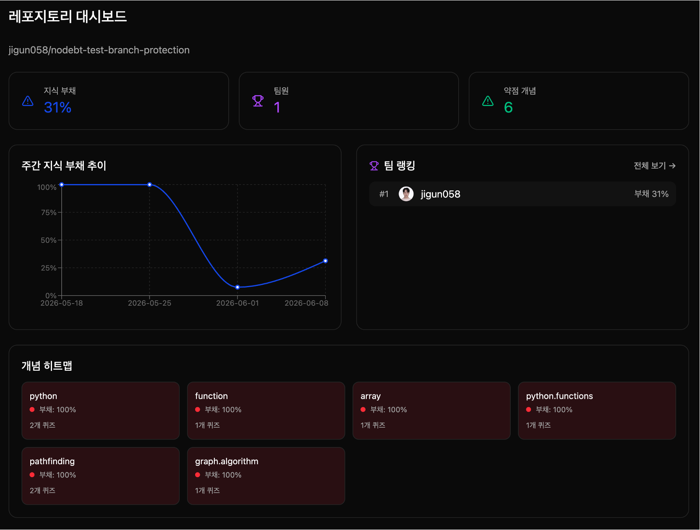

2026 컴퓨터과학종합설계 · 3조 <b>아자스</b>

 

## 📌 30초 요약

> 🤖 **문제** — Copilot·Cursor 같은 AI 덕분에 코드는 빨리 쓰지만, *내가 무슨 코드를 썼는지 모르는 상태*가 쌓이고 있습니다. 우리는 이것을 **지식 부채(Knowledge Debt)** 라고 부릅니다.
>
> 🧩 **해결** — 개발자가 코드를 올리면(PR), 봇이 바뀐 부분을 읽고 AI로 **맞춤형 퀴즈**를 만듭니다.
>
> 🚦 **결과** — 퀴즈를 풀어 이해했음을 증명하면 🟢 초록불, 아니면 🔴 빨간불이 켜지고 **Merge가 막힙니다.**

 

## 🤔 왜 만들었나요?

개발을 해 보지 않은 분이라면 이렇게 생각해 보세요.

> 📝 **AI가 대신 써 준 리포트를 그대로 제출하는 학생**이 있다고 해 봅시다. 
> 제출은 빨리 끝났지만, 교수님이 "이 문단은 무슨 뜻이죠?"라고 물으면 대답하지 못합니다. 
> 그 순간은 넘어가도, 나중에 그 내용을 고치거나 설명해야 할 때 **이해하지 못한 만큼의 '빚'** 을 갚아야 합니다.

소프트웨어 팀에서도 똑같은 일이 일어납니다.

<table>
<tr>
<td align="center" width="33%"><h2>76%</h2>AI 코딩 도구를 써 본 개발자 Stack Overflow Developer Survey, 2024</td>
<td align="center" width="33%"><h2>55%</h2>AI가 만든 코드를 검토 없이 수락 GitClear, 2024</td>
<td align="center" width="33%"><h2>0명</h2>Merge 후 작성자의 이해도를 검증하는 사람</td>
</tr>
</table>

- **PR이 Merge됐다고 이해가 끝난 걸까요?** 아니요. 텍스트 리뷰만으로는 변경의 맥락과 의도가 팀에 온전히 전달되지 않습니다.
- **코드 리뷰가 끝나면 지식은 사라집니다.** 특히 새로 합류한 팀원은 바뀐 로직을 따라잡기 어렵습니다.
- 이해 없는 병합 → 기술 부채 누적 → **장기 유지보수 비용**

**no-dept**는 이 빚이 쌓이기 전에, 코드를 올리는 바로 그 순간에 **작은 퀴즈로 이해도를 확인**합니다.

 

## 🔄 어떻게 동작하나요?

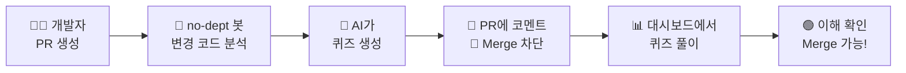

1. **코드 올리기** — 개발자가 GitHub에 Pull Request(PR)를 엽니다.
2. **변경 내용 읽기** — 봇이 이번에 바뀐 코드만 골라냅니다. 오타 수정·주석·문서·의존성 파일 변경처럼 **배울 거리가 없는 PR은 자동으로 건너뜁니다.**
3. **퀴즈 만들기** — 코드를 의미 단위(함수, 클래스 등)로 쪼갠 뒤, AI(LLM)가 **객관식·빈칸 채우기 퀴즈**를 만듭니다.
4. **신호등 켜기** — PR에 봇 코멘트가 달리고, 퀴즈를 다 풀기 전까지는 🔴/🟡 상태로 표시됩니다.
5. **풀고 통과하기** — 웹 대시보드에서 퀴즈를 풀면 상태가 🟢로 바뀌고 Merge할 수 있게 됩니다.

### 🚦 신호등 게이트키퍼 (Traffic Light)

| 상태 | 언제? | PR에 달리는 메시지 |
|:--:|:--|:--|
| 🟢 **GREEN** | 모든 퀴즈 해결 | ✅ 통과: Knowledge Check 완료 |
| 🟡 **YELLOW** | 미해결 퀴즈 1개 또는 누적 부채 40% 이상 | ⚠️ 경고: 일부 퀴즈가 아직 미해결입니다 |
| 🔴 **RED** | 미해결 퀴즈 2개 이상 또는 누적 부채 70% 이상 | ❌ Blocked: 이 PR의 코드 변경량에 비해 작성자의 이해도가 낮습니다 |

> PR 단위 상태와 개인의 누적 부채 중 **더 엄격한 쪽**으로 색이 정해집니다.

팀마다 개입 강도를 고를 수 있습니다.

- **유연(SOFT)** — 신호등과 경고만 보여 주고, Merge는 막지 않습니다. 실험적인 기능을 빠르게 개발할 때 좋습니다.
- **엄격(STRICT)** — GitHub Branch Protection을 자동 설정해 **관리자도 예외 없이** 퀴즈를 통과해야 Merge할 수 있습니다.

 

## 🖥️ 사용자가 마주하는 화면

### ① 로그인 & 리포지토리 연동
GitHub 계정으로 원클릭 로그인하고, 봇이 설치된 리포지토리를 골라 시작합니다. 각 리포지토리의 README는 AI가 **한 줄로 요약**해 보여 줍니다.

<table>
<tr>
<td width="50%">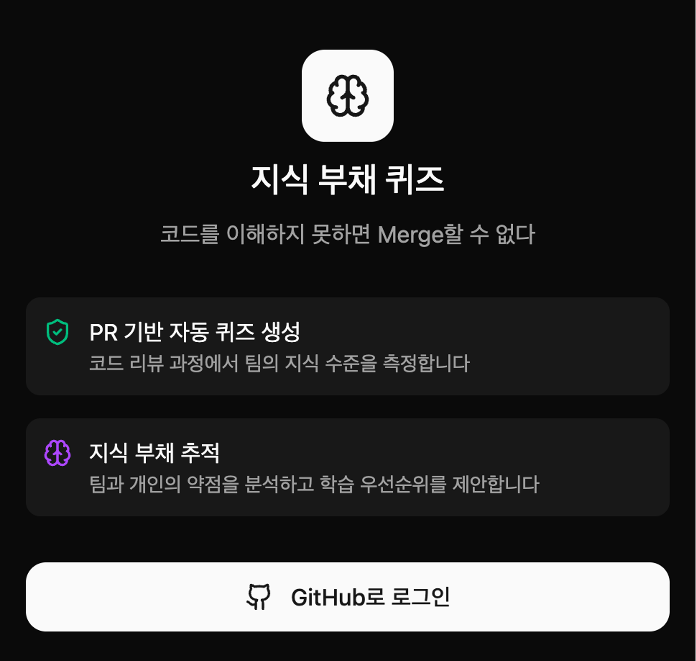</td>
<td width="50%">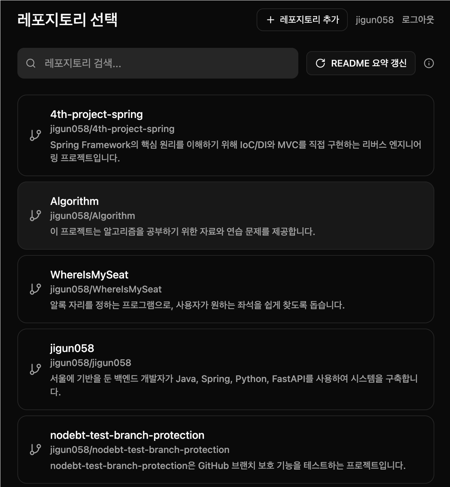</td>
</tr>
</table>

### ② 퀴즈 선택 & 풀이
PR별로 자동 생성된 퀴즈 목록에서 원하는 문제를 골라 풉니다. 객관식과 빈칸 채우기 두 가지 유형이 있고, 문제마다 관련 개념 태그가 붙습니다.

<table>
<tr>
<td width="50%">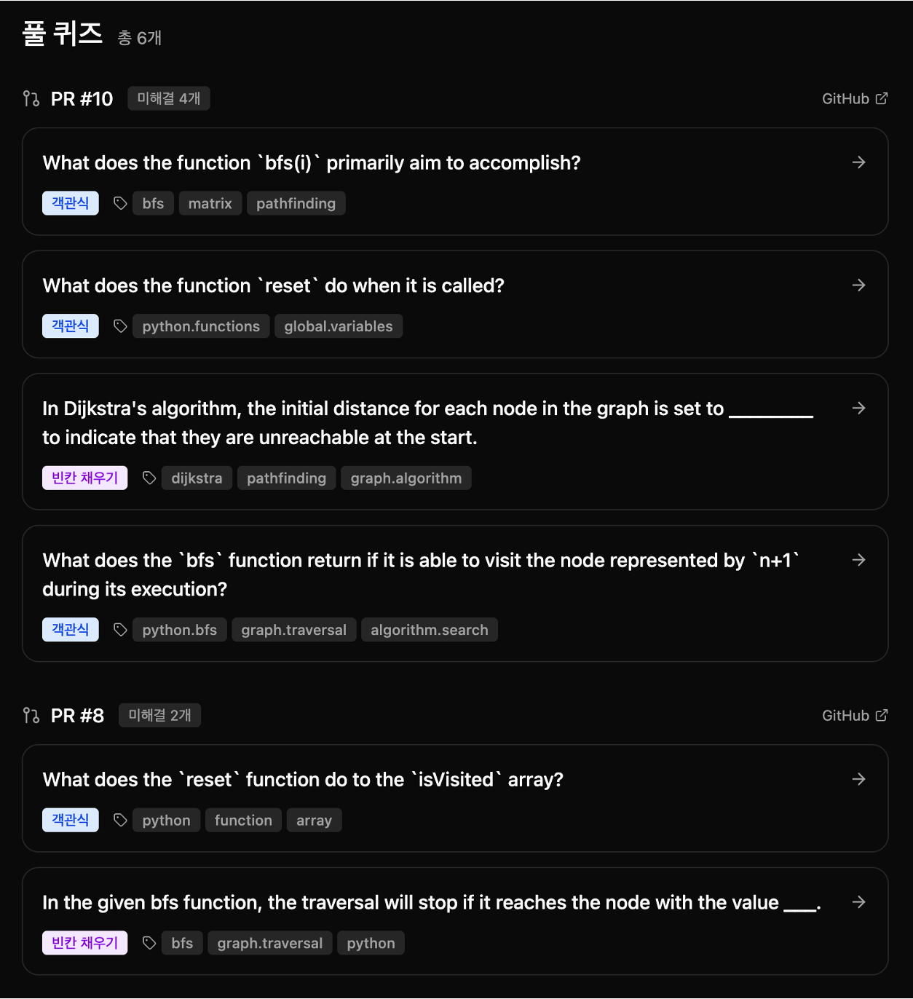</td>
<td width="50%">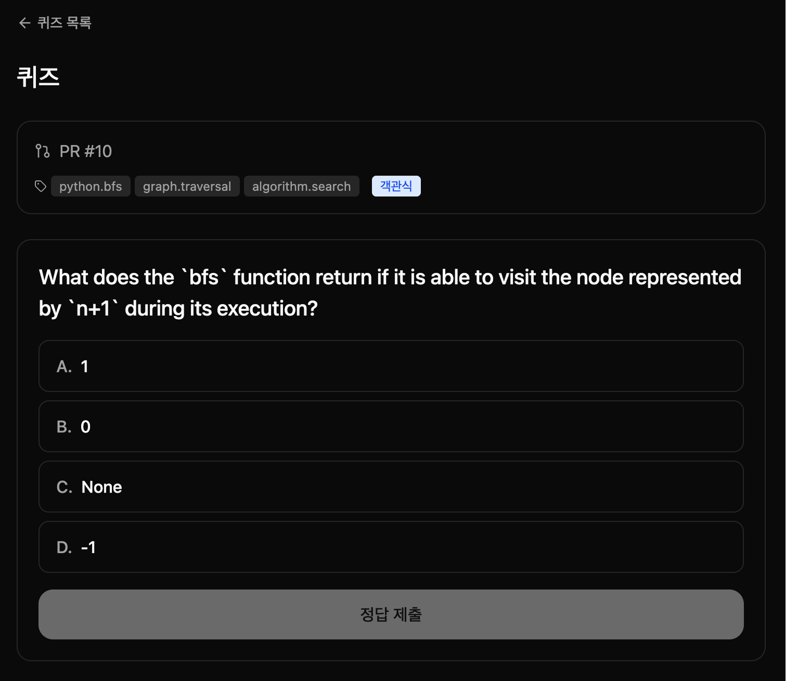</td>
</tr>
</table>

### ③ 나의 지식 부채 대시보드
내 부채 점수, 연속 기록, **첫 시도 정답률 / 최종 정답률**, 주간 추이와 약점 개념을 한 화면에서 확인합니다.

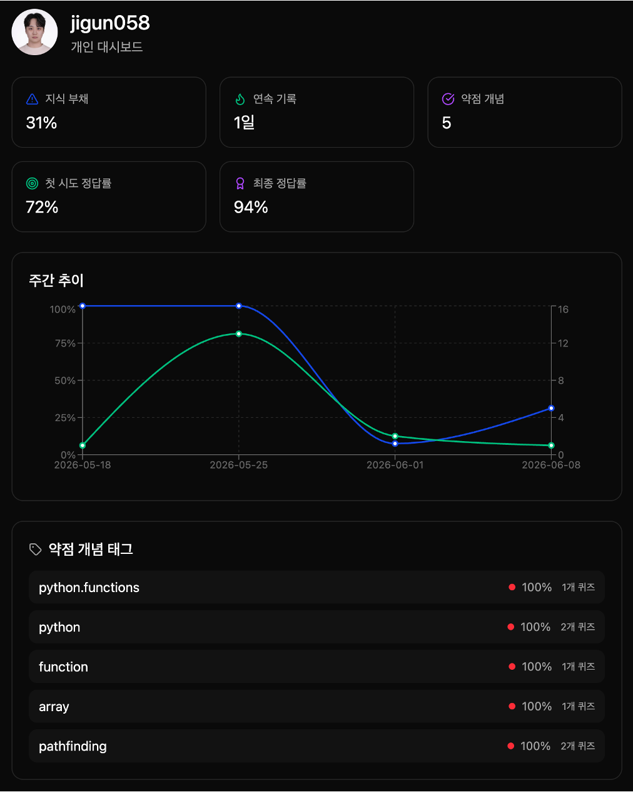

### ④ 팀 현황 · 랭킹 · 이력
팀 전체의 개념 히트맵(맨 위 화면)과 팀원별 지식 부채 순위를 한눈에 보고, 나와 팀원이 어떤 문제를 풀었는지 이력을 확인할 수 있습니다.

<table>
<tr><td>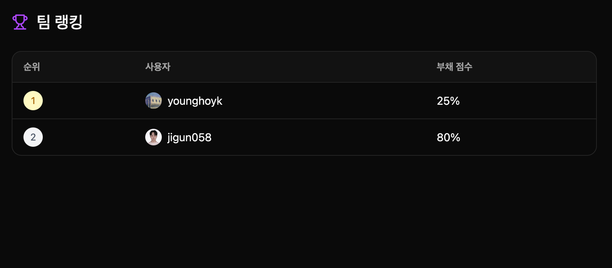</td></tr>
<tr><td>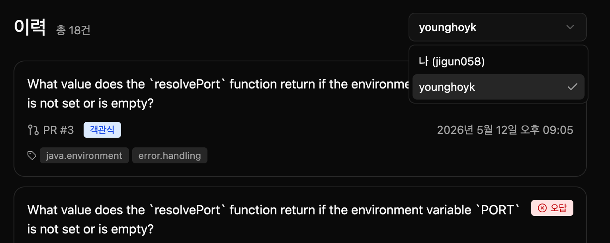</td></tr>
</table>

 

## 🧮 지식 부채는 어떻게 계산하나요?

퀴즈 하나하나에 "빚"을 매기고, 그 평균이 나의 **지식 부채 점수**(0~100%)가 됩니다.

| 퀴즈 결과 | 남는 빚 | 의미 |
|:--|:--:|:--|
| ✅ 첫 시도에 정답 | **0.0** | 완전히 이해함 — 빚 없음 |
| 🔁 틀렸지만 결국 정답 | **0.3** | 이해는 했지만 조금 헷갈림 |
| ❌ 아직 안 풀었음 | **1.0** | 이해를 확인하지 못함 — 빚 유지 |

점수는 볼 때마다 최신 상태로 계산되며, 지난 주의 기록은 그때 값 그대로 고정되어 **주간 추이 그래프**로 보여집니다.

 

## 🆚 기존 도구와 무엇이 다른가요?

기존 도구는 **'코드 품질 개선'** 에 집중합니다. no-dept는 그 위의 레이어, **'작성자의 이해도 검증'** 을 담당합니다.

| 기능 | CodeRabbit | Graphite | GitHub Copilot | **no-dept** |
|:--|:--:|:--:|:--:|:--:|
| 코드 품질 리뷰 | ✅ | ✅ | ✅ | – |
| PR 자동 요약 | ✅ | ✅ | ✅ | – |
| **이해도 퀴즈 생성** | ❌ | ❌ | ❌ | ✅ |
| **Merge Gatekeeper** | ❌ | ❌ | ❌ | ✅ |
| **지식 부채 수치화** | ❌ | ❌ | ❌ | ✅ |
| 코드 원본 미저장 | ✅ | ✅ | ✅ | ✅ |

> no-dept는 기존 도구와 경쟁하지 않습니다. CodeRabbit이 코드 품질을 보완하는 동안 no-dept는 개발자의 이해도를 검증하며, 같은 워크플로 위에서 **상호 보완적으로** 작동합니다.

 

## 💬 사용자 피드백

시연 후 개발자 **21명**에게 설문을 받았습니다. (5점 만점)

| 항목 | 평균 |
|:--|:--:|
| 😊 전반적인 만족도 | **4.52** |
| 💡 PR 퀴즈 자동 생성 기능의 유용성 | **4.52** |
| 🎨 UI/UX 편의성 | **4.67** |
| ✅ 채점 결과의 직관성 | **4.33** |
| 🧠 생성된 퀴즈의 품질 | **4.29** |

- 🙋 팀 프로젝트 도입 의향: **적극적으로 사용 7명 · 상황에 따라 사용 12명** · 잘 모르겠음 2명
- 🤔 도입 시 가장 큰 우려: **보안(코드 외부 전송) 10명**, LLM API 비용 8명

> 💭 *"AI가 제공한 그대로 코드를 작성하고 기능이 잘 되는지만 확인하는 방식으로 개발했었는데, 강제성을 부여해서라도 코드 변경점에 대한 내용을 학습할 수 있었던 것이 학습 측면에서 아주 좋았습니다."*
>
> 💭 *"AI에게 코드 설명을 하나하나 부탁하는 것이 아니라, 자동으로 중요한 부분을 캐치해서 알아서 질문을 해 준다는 부분이 좋았다."*
>
> 💭 *"퀴즈 차단 강도를 조절할 수 있어, 실험적 기능 개발처럼 코드 리뷰를 간소화해야 하는 경우에도 대응할 수 있어 적절한 것 같습니다."*

 

## 🏗️ 시스템 구조

> 💡 여기부터는 개발자를 위한 내용입니다.

AWS 서버리스 위에서 **비동기 경로**(Webhook → 퀴즈 생성)와 **동기 경로**(대시보드 ↔ API)를 분리했습니다.

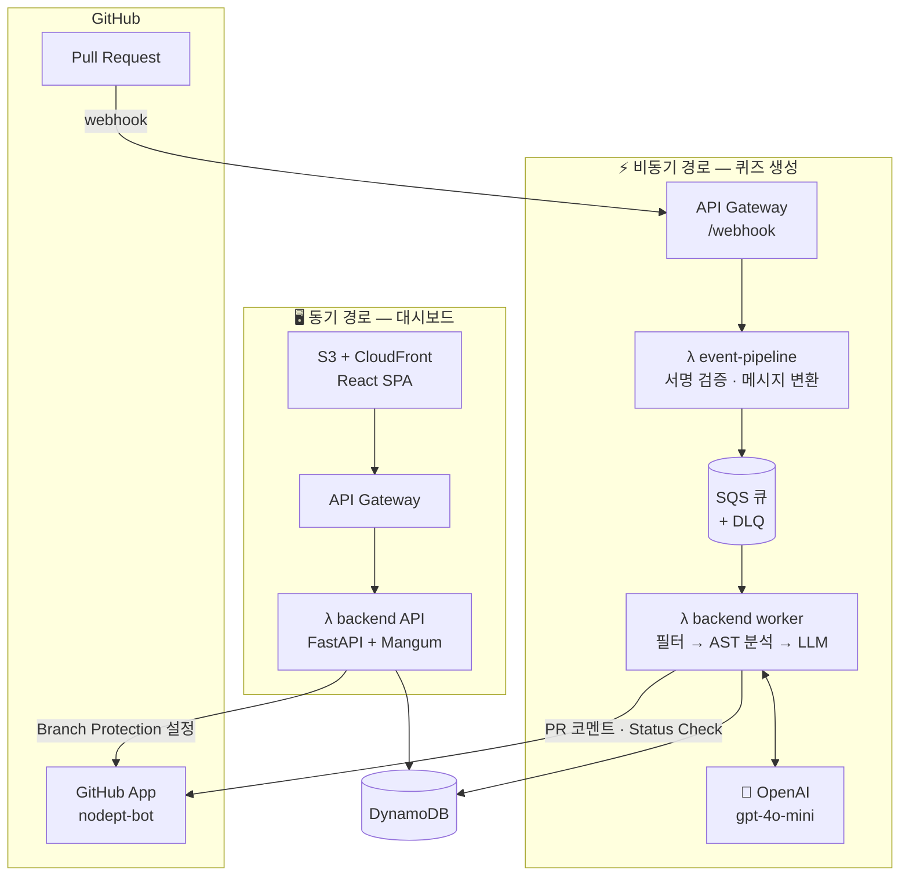

**설계 원칙**

- 💸 **LLM은 꼭 필요할 때만** — 퀴즈 생성 · 개념 설명 · README 요약에만 사용하고, 채점은 결정적(deterministic) 알고리즘으로 처리
- 🧹 **룰 기반 사전 필터** — 문서·lockfile·주석만 바뀐 PR, 5줄 미만의 작은 변경은 LLM 호출 자체를 생략
- 📐 **단일 스키마** — 모든 레포가 `shared-schema`의 Pydantic 모델을 공유해, 레포 간 데이터 형식이 어긋나지 않도록 보장
- 🔁 **안정적인 이벤트 처리** — SQS 부분 실패 재시도 + DLQ + CloudWatch 알람

<b>🗄️ DynamoDB 테이블 설계 (8개)</b>

 

| 테이블 | PK | SK | GSI | 용도 |
|:--|:--|:--|:--|:--|
| users | userId | | | OAuth 연동 사용자 프로필 |
| repos | repoId | | installedBy-index | 봇이 설치된 리포지토리 |
| projects | repoId | projectId | | 리포지토리 내부 모듈 단위 구조 정보 |
| quizzes | quizId | | assignee-status-index, repo-pr-index | AST + AI로 생성된 문제 |
| answers | userQuizId | | | 제출 답안 · 채점 결과 · 풀이 로그 |
| stats | statsKey | | | 현재 미사용 (향후 사전 집계용) |
| concept_descriptions | tag | | | 약점 개념 설명 LLM 캐시 |
| readme_summaries | repoId | | | README 한 줄 요약 캐시 |

 

## 🔧 기술적으로 신경 쓴 점

<table>
<tr>
<td width="50%" valign="top">

### 🔐 보안 · 신뢰성
- **HMAC-SHA256 서명 검증** — 파싱된 JSON이 아닌 **원본 바이트**로 검증해, 공백·키 순서 변화로 서명이 깨지는 문제를 방지
- **Timing Attack 방어** — `hmac.compare_digest()`로 비교 시간을 고정
- **멱등성(Idempotency)** — GitHub `deliveryId`를 키로 삼아, 같은 요청이 재시도돼도 퀴즈가 중복 생성되지 않음
- **스키마 강제** — `extra="forbid"`로 레포 간 데이터 형식 불일치를 즉시 에러로 차단

</td>
<td width="50%" valign="top">

### ⚡ 성능 · 비용
- **GitHub 5초 타임아웃 회피** — Webhook은 검증 후 SQS에 넣고 즉시 200 OK, 무거운 AST 분석·LLM 호출은 Worker가 비동기 처리
- **콜드 스타트 최적화** — Secrets Manager 조회를 모듈 최상단으로 옮겨 최초 1회만 호출
- **로컬 재현성** — Docker Compose로 DynamoDB Local + Admin UI를 띄워 운영과 같은 환경에서 검증
- **서버리스 과금** — 트래픽에 비례해서만 비용 발생, 초기 고정비 없음

</td>
</tr>
</table>

### 🚨 장애 격리 & 실시간 경보

Worker가 OpenAI Rate Limit 등으로 **5회 연속 실패**하면 메시지를 버리지 않고 **DLQ로 옮겨 14일간 보관**합니다. DLQ에 메시지가 1개라도 쌓이면 CloudWatch 알람 → SNS → 팀 이메일로 즉시 알림이 갑니다.

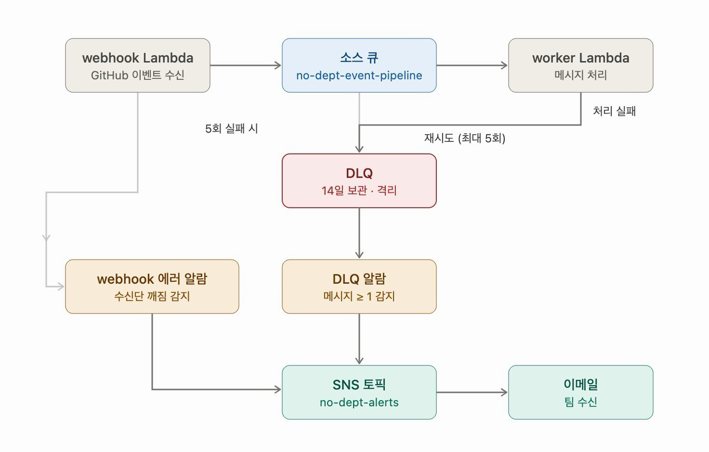

<b>🐛 로그 분석으로 잡은 3대 버그</b>

 

| 버그 | 증상 | 해결 |
|:--|:--|:--|
| ① `deliveryId` 중복 검증 누락 | GitHub의 재시도로 같은 퀴즈가 여러 번 생성됨 | Worker에 `deliveryId` 기반 중복 검증 레이어 도입 |
| ② `synchronize` 이벤트 누락 | PR을 처음 열 때만 퀴즈가 생기고, 코드를 수정해 업데이트하면 새 퀴즈가 안 생김 | PR 업데이트 이벤트까지 처리하도록 로직 보완 |
| ③ Base64 body HMAC 에러 | API Gateway가 body를 Base64로 넘겨 원본 바이트 검증이 깨짐 | 인코딩 플래그에 따라 디코딩 분기 처리 |

 

## 📦 리포지토리 구성

| 리포지토리 | 한 줄 설명 | 주요 기술 |
|:--|:--|:--|
| 🧠 [**backend**](https://github.com/no-dept/backend) | 대시보드 API + 퀴즈 생성 워커 + AI 퀴즈 엔진 | Python · FastAPI · OpenAI · Tree-sitter |
| 🎨 [**dashboard**](https://github.com/no-dept/dashboard) | 퀴즈를 풀고 지식 부채를 확인하는 웹 화면 | React · TypeScript · Vite · Tailwind |
| 📡 [**event-pipeline**](https://github.com/no-dept/event-pipeline) | GitHub 이벤트를 받아 작업 큐로 전달 | AWS Lambda · SQS |
| 📐 [**shared-schema**](https://github.com/no-dept/shared-schema) | 모든 레포가 공유하는 데이터 모델 | Python · Pydantic v2 |
| ☁️ [**infra**](https://github.com/no-dept/infra) | AWS 인프라 코드 + 운영 문서 | Terraform · AWS |

<b>🧠 backend</b> — 시스템의 두뇌

 

하나의 코드베이스를 로컬에선 **FastAPI(uvicorn)**, 운영에선 **AWS Lambda(Mangum)** 로 실행합니다.

- **`api/`** — 대시보드용 REST API (인증, 리포지토리, 퀴즈, 통계, 이력, 개념 설명, 설정)
- **`workers/`** — SQS 메시지를 받아 PR 퀴즈 생성 / GitHub App 설치·삭제 처리
- **`ai_quiz/`** — diff 파싱 → Tree-sitter AST 청킹 → OpenAI Structured Outputs로 퀴즈 생성 Python, Java, JS, TS, Go, Ruby, C, C++, C#, Rust 지원 · PR당 최대 10문제 (객관식 2 : 빈칸 1)
- **`services/`** — 채점(정규화 + Levenshtein 유사도), 신호등 판정, PR 코멘트, 사소한 PR 필터, Branch Protection 동기화, 지식 부채 통계, README 요약
- **`integrations/`** — GitHub App(Installation Token) 클라이언트
- 퀴즈 정답 필드는 응답에서 제외해, 브라우저 개발자 도구로도 정답을 볼 수 없음
- pytest + moto로 AWS 의존 로직까지 테스트, ruff · mypy로 품질 관리
- GitHub Actions + OIDC로 `main` 푸시 시 Lambda 자동 배포

<b>🎨 dashboard</b> — 사용자가 만나는 얼굴

 

Figma Make로 시작한 디자인을 기반으로 React SPA로 구현했습니다. 다크/라이트 모드와 한국어 UI를 지원합니다.

| 화면 | 설명 |
|:--|:--|
| 로그인 | GitHub OAuth 로그인 |
| 리포지토리 선택 | 연결된 리포지토리 목록 + AI README 한 줄 요약 |
| 팀 대시보드 | 리포지토리 전체 지식 부채, 주간 추이, 개념 히트맵 |
| 개인 대시보드 | 내 부채 점수, 연속 기록, 첫 시도/최종 정답률 |
| 퀴즈 목록 · 풀이 · 결과 | PR별로 묶인 미해결 퀴즈를 골라 풀기 |
| 약점 분석 | 개념별 히트맵 + 호버 시 AI 개념 설명 |
| 팀 랭킹 · 이력 | 팀원 순위, 본인/팀원 풀이 기록 |
| 설정 | 개입 강도(유연/엄격) 선택 → Branch Protection 자동 반영 |

- **Context API 전역 상태** — `AuthContext`(JWT · OAuth), `RepoContext`(선택 리포지토리), `ThemeContext`(다크/라이트 + CSS 변수)
- **API 레이어 분리** — Bearer 토큰 자동 주입, 에러 처리 중앙화
- **타입 자동 생성** — backend의 OpenAPI 명세에서 `openapi-typescript`로 생성해 프론트-백 간 타입 불일치 방지
- shadcn/ui · Radix UI · Recharts · sonner 사용, GitHub Actions로 S3 + CloudFront 자동 배포

<b>📡 event-pipeline</b> — GitHub과 시스템을 잇는 관문

 

GitHub Webhook을 받아 SQS에 넣는 가벼운 Lambda 함수입니다. 비즈니스 로직은 갖지 않고 "받아서 검증하고 전달"하는 역할에 집중합니다.

1. `X-Hub-Signature-256` **HMAC-SHA256 서명 검증** (원본 바이트 기준, timing-safe 비교)
2. 이벤트 분류 — PR 열림/업데이트, PR Merge, App 설치/삭제
3. `shared-schema` 메시지 타입으로 변환 후 SQS 전송

<b>📐 shared-schema</b> — 모두가 같은 언어로 말하게

 

모든 레포가 공유하는 데이터 모델의 **단일 진실 원천(Single Source of Truth)** 입니다.

- **`entities/`** — DB에 저장되는 엔티티 (User, Repo, Quiz, Answer, Settings, ConceptDescription 등)
- **`api/`** — dashboard ↔ backend 요청/응답 모델
- **`messages/`** — event-pipeline → worker(SQS), AI 엔진 → worker(LLM 결과) 메시지
- `extra="forbid"` 정책으로 필드 불일치를 즉시 에러로 잡아냄
- 스키마 변경 → backend 배포 확인 → dashboard 타입 갱신 → 배포 순서로 **순차 배포**

<b>☁️ infra</b> — 모든 것이 돌아가는 무대

 

Terraform으로 AWS 자원을 코드로 관리합니다.

- DynamoDB 테이블, Lambda(API · Worker), API Gateway, S3 + CloudFront, Secrets Manager, IAM
- GitHub Actions 배포용 **OIDC** 역할 (장기 Access Key 없이 배포)
- SQS **DLQ + CloudWatch 알람 + SNS 이메일 알림**과 장애 대응용 **DLQ 런북** 문서

 

## 🛠️ 기술 스택

**Backend & AI** 

**Frontend** 

**Infra & DevOps** 

 

## 🛡️ 보안과 개인정보

- 🚫 **코드 원본은 저장하지 않습니다** — AI가 만든 퀴즈와 모듈 설명만 저장합니다.
- 🔒 LLM API에 **데이터 보관 없음(Zero Data Retention)** 정책을 적용합니다.
- 🗄️ DynamoDB 저장·전송 구간 모두 암호화합니다.
- 🔑 Webhook 서명 검증, 비밀 값은 AWS Secrets Manager로 관리합니다.
- 🙈 퀴즈 정답은 서버에만 두어, 브라우저 개발자 도구로도 볼 수 없습니다.

 

## 🔭 앞으로의 계획

| 분야 | 계획 |
|:--|:--|
| 🧩 서비스 | 단순 LLM 생성을 넘어 실제 수요 있는 **퀴즈 데이터베이스** 구축 |
| 💻 확장 | **IDE 통합**으로 PR 생성 전 이해도 체크, Self-hosted · SSO를 지원하는 **Enterprise 티어** |
| ☁️ 인프라 | Terraform State를 S3 + DynamoDB Lock으로 이관, 런타임 Secrets Manager 조회, 커스텀 도메인 + ACM 인증서 |

**주요 타깃** — 1차: 주니어 개발자 · 부트캠프 수강생 / 2차: 사이드 프로젝트 개발자 / 3차: 테크 리드 · CTO

 

## 👥 팀 아자스

| 이름 | 역할 | 담당 |
|:--:|:--|:--|
| **이도권** [@dokwon33](https://github.com/dokwon33) | 👑 팀장 · FE 기획 | UI/UX 총괄 |
| **이태권** [@jigun058](https://github.com/jigun058) | 🛠️ BE · FE 겸임 | UI 설계, 대시보드 구현, 백엔드 API, DB · 인프라 |
| **유영호** [@younghoyk](https://github.com/younghoyk) | 🧠 LLM 엔진 | 퀴즈 생성 엔진, 지식 부채 알고리즘 설계 |
| **조우형** [@woo0109](https://github.com/woo0109) | 📡 파이프라인 | GitHub App, Webhook & 이벤트 처리 |

**협업 방식** — 4인 4역 · 공유 스키마로 파트 간 연결 · GitHub 기반 코드 리뷰 · 기능 단위 반복 개발 후 실서비스에서 직접 검증

 

## 📖 용어 사전

개발이 처음이라면 펼쳐 보세요

 

| 용어 | 쉬운 설명 |
|:--|:--|
| **바이브코딩** | AI에게 말로 설명해서 코드를 받아 쓰는 개발 방식 |
| **지식 부채** | 내가 올린 코드인데 내가 이해하지 못한 부분. 나중에 갚아야 할 "이해의 빚" |
| **GitHub** | 개발자들이 코드를 저장하고 함께 작업하는 온라인 공간 |
| **PR (Pull Request)** | "제가 고친 코드를 합쳐 주세요"라는 요청서 |
| **Merge** | PR의 코드를 실제 본 코드에 합치는 것 |
| **Diff** | 이번에 바뀐 코드 부분만 뽑아 낸 것 |
| **Webhook** | GitHub에서 무슨 일이 생기면 우리 서버에 자동으로 알려 주는 알림 |
| **LLM** | ChatGPT 같은 대규모 언어 모델(AI) |
| **Branch Protection** | 조건을 만족하지 않으면 코드를 합치지 못하게 막는 GitHub 기능 |
| **서버리스** | 서버를 직접 관리하지 않고, 필요할 때만 클라우드가 코드를 실행해 주는 방식 |

 

**AI로 더 빠르게, 하지만 이해는 우리 몫으로.** 🧠

© 2026 Team 아자스 (no-dept) · 컴퓨터과학종합설계

